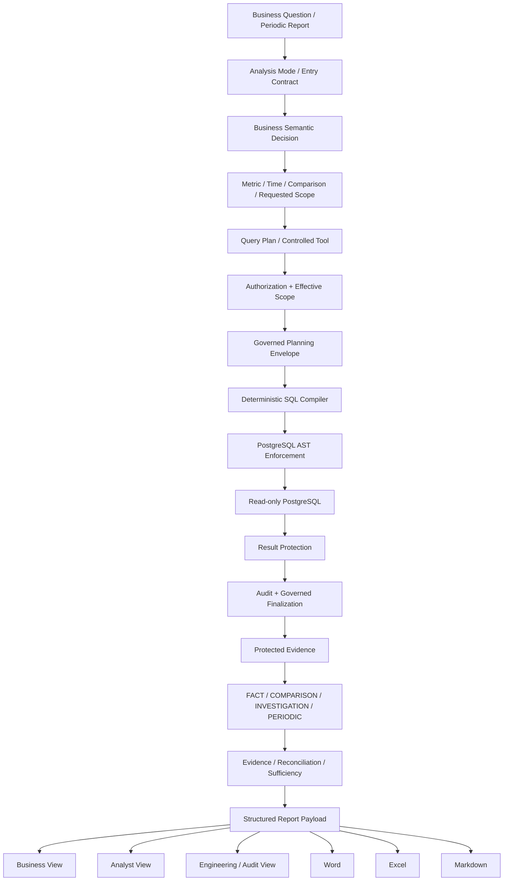

# AI-Architect-100Days

一个面向企业 BI 场景的可信 AI Data Analyst / AI BI Agent 项目。

它不是单纯的 Text-to-SQL Demo，而是尝试解决一个更难的问题：

> 如何让 AI 在企业业务语义、权限、数据安全和证据边界内，完成可验证的经营分析与受控调查。

当前系统围绕 Beauty BI Dataset V2，形成了：

```text
Natural Language / Periodic Report Request
↓
Business Semantic Decision
↓
Deterministic Trust Plane
↓
Governed PostgreSQL
↓
Protected Evidence
↓
Bounded Agentic Investigation
↓
FACT / COMPARISON / INVESTIGATION / PERIODIC
↓
Decision Console / Word / Excel / Markdown
```

---

## 1. Why This Project

传统 BI 的难点并不只是“不会写 SQL”。

真实企业分析通常还包含：

- 指标定义并不透明；
- 同一个词可能对应多个业务口径；
- 用户有权限看到什么，与指标适用于什么并不是一回事；
- SQL 能执行，不代表业务答案正确；
- 维度拆解能对上，不代表已经证明业务原因；
- AI 可以提出调查方向，但不能自由修改 Metric、权限或 SQL 可信边界；
- 业务用户需要能验证一个数字从哪里来，而不是只能“相信模型”。

因此本项目最终采用：

```text
Deterministic Trust Plane
+
Bounded Agentic Investigation Plane
```

核心原则是：

```text
Model proposes
Contract constrains
Governed Executor performs
Evidence supports
Business user verifies
```

---

## 2. Current Product

### 2.1 FACT — 事实查询

示例：

```text
2025年上海地区GMV是多少？
```

系统可以交付：

- trusted Overall KPI；
- Metric Definition；
- Time Window；
- Effective Scope；
- 已发布的 Composition；
- Evidence / Provenance；
- Reconciliation。

代表性本地验收：

```text
上海地区 2025 GMV
= 1,015,873.29

渠道构成
→ reconciled

品类构成
→ reconciled

Cross-dimensional trusted Overall
→ same Overall = 1,015,873.29
→ unexplained remainder = 0.00
```

当前公开 Composition：

```text
Channel Composition   RELEASED
Category Composition  RELEASED
People Composition    DEFERRED
```

People Composition 暂不公开的原因见「Known Boundaries」。

---

### 2.2 COMPARISON — 对比分析

示例：

```text
2025年10月GMV和9月相比如何？
```

代表性结果：

```text
2025-09 GMV = 847,765.20
2025-10 GMV = 1,231,371.04
Delta         = +383,605.84
Delta Rate    = +45.25%
```

COMPARISON 有独立分析模式：

```text
comparison
≠
investigation
```

纯比较请求不会被静默升级为深入调查。

---

### 2.3 INVESTIGATION — 受控业务调查

示例：

```text
2025年10月GMV和9月相比如何？
如果发生变化，应该查看什么方面？
```

系统将同一 Comparison 作为调查 Seed，并在合法 Tool Boundary 内继续调查：

```text
Overall Comparison
↓
Channel Change
↓
Geography Change
↓
Campaign Change
↓
Evidence / Reconciliation
↓
Can Confirm
↓
Cannot Confirm / Causal Boundary
↓
Recommended Next Step
```

代表性 2025-09 → 2025-10 Investigation：

```text
Overall Delta
+383,605.84

Channel Change
→ reconciled

Geography Change
→ reconciled

Campaign Change
→ reconciled
```

Campaign 可能出现大于 100% 的 contribution rate，因为：

```text
positive contribution
+
negative offset
=
net overall delta
```

例如活动归因订单增加，同时非活动订单下降。

系统允许说：

```text
“GMV 数值变化主要集中在某些活动归因订单”
```

但不会自动升级成：

```text
“该活动造成了增量”
“该活动 uplift = ...”
“已经找到最终业务根因”
```

因为当前没有反事实 / 实验对照。

---

### 2.4 PERIODIC — 周期经营报表

支持手动生成：

```text
Daily   → DOD
Weekly  → natural-week WOW
Monthly → MOM
```

当前交付包括：

- 本期经营摘要；
- 经营概览；
- 销售驱动；
- 客户健康；
- R12 Customer Metrics；
- deterministic driver reconciliation；
- 本期限制；
- Word / Excel / Markdown 导出。

示例 Driver Relationship：

```text
GMV = Buyer Count × Spending
→ reconciled

Spending = AUS × FREQ
→ reconciled
```

对于 ratio / derived metric，系统不会错误地把各维度 ratio 相加来做 reconciliation，而是验证其 constituent / arithmetic relationship。

---

## 3. Architecture

### 3.1 End-to-End



---

### 3.2 Deterministic Trust Plane

```text
Business Semantic Layer
+
Authorization / Effective Scope
+
Query Plan Contract
+
Deterministic SQL Compilation
+
PostgreSQL AST Enforcement
+
Execution Policy / Budget
+
Result Protection
+
Audit / Governed Finalization
```

这个 Plane 决定：

```text
能查什么
怎么算
哪些 Scope 必须保留
SQL 是否仍符合原合同
结果是否允许释放
Audit 是否成功持久化
```

LLM 不能绕过它。

---

### 3.3 Bounded Agentic Investigation

```text
Protected Evidence
+
Investigation State
+
Authorization-filtered Available Actions
↓
LLM Planner Proposal
↓
Deterministic Validation
↓
Trusted Tool Binding
↓
Governed Execute
↓
Observation
↓
State Update
↓
RETRY / REPLAN / RECOVER / STOP / CLARIFY
```

LLM 可以：

- 在合法动作集合中选择下一步；
- 基于 Evidence 给出 rationale；
- 在信息不足时请求 clarification；
- 根据新 Observation 改变调查方向。

LLM 不能：

- 提交 raw SQL；
- 重新定义 metric formula；
- 修改 permission；
- 覆盖 requested scope；
- 绕过 Query Plan / AST / Result Protection；
- 把 Contribution 自动升级为因果解释。

---

## 4. Business Semantic Layer

系统不要求 LLM 自己“猜企业指标”。

Business Semantic Layer 管理：

```text
Metric Definition
Result Grain
Query Plan
Time Semantics
Scope Semantics
Table / Column Contract
Result Shape
Sensitivity Policy
```

当前 Dataset V2：

```text
Schema：16 tables
Metadata V2：24 metrics
Query Plans V2：60
Dataset Status：candidate
```

复杂指标可以通过 staged / deterministic Query Plan 处理，而不是全部交给 Prompt 自由生成 SQL。

---

## 5. Governance & Security

当前 Governance Chain：

```text
Trusted AccessContext
↓
Metric / Table / Column Authorization
↓
Region / Channel Row Scope
↓
Governed Planning Envelope
↓
Compiled SQL Contract
↓
PostgreSQL AST Enforcement
↓
Dedicated Read-only Query Role
↓
statement_timeout / max_rows
↓
Result Protection
↓
Structured Audit Event
↓
Hash-chain Audit Sink
↓
Governed Finalization
```

关键边界：

```text
Authorized Scope
≠
Metric Applicable Scope
≠
Requested Scope
≠
Investigation Focus
```

最终 Effective Scope：

```text
Authorized
∩ Metric Applicable
∩ Requested
∩ Investigation Focus
```

当前 Agent 仍然是：

```text
Observe / Advise
```

不是写库 Agent。

---

## 6. Trust & Verification

项目的一个核心目标是：

> 用户不只得到一个数字，还能验证这个数字。

### 6.1 KPI → Composition

对于 additive metric：

```text
trusted Overall
↓
dimension members
↓
member sum
↓
unexplained remainder
↓
reconciliation status
```

UI / Word / Excel 不会通过重新求和可见表格去制造新的“Overall Truth”。

### 6.2 Evidence / Provenance

Evidence 可以绑定：

- Metric Definition；
- Time Window；
- Effective Scope；
- Query Plan；
- Compiler / Contract Fingerprint；
- protected result；
- Audit reference；
- parent evidence lineage。

### 6.3 Epistemic Boundary

系统区分：

```text
Confirmed Fact
Detected Anomaly
Dimension Contribution
Candidate Hypothesis
Unknown
Recommended Check
```

并明确：

```text
Contribution
≠
Causality
```

---

## 7. Business Delivery

当前 Decision Console 提供三层视图：

```text
Business Decision View
Analyst Investigation View
Engineering / Audit View
```

它们不是三套独立结论，而是同一份受治理结果的不同 projection。

### Business Artifact

正式业务交付：

```text
Word
Excel
```

技术 / Portfolio：

```text
Markdown
```

HTML renderer 可以保留，但不作为当前 Business UI 主交付格式。

Artifact 层遵守：

```text
No re-query
No new LLM conclusion
No independent KPI recalculation
No bypass of protected result
```

---

## 8. Evaluation

当前评估体系不是单一测试脚本，而是多层 Gate：

```text
Deterministic Regression
+
PostgreSQL Integration
+
Security / Governance
+
Performance
+
Fresh / Post-failure Generalization
+
Business Decision Quality
+
Human Calibration
+
Manual UX / Public Delivery Acceptance
```

### Day94 Local Final Regression

```text
Gate A
Deterministic / Presentation / Export
PASS

Gate B1
Composition Contract / PostgreSQL
PASS

Gate B2
Periodic / R12 / Evidence / Trust
PASS
```

最终本地冻结：

```text
Final Regression                 PASS
Trust & Verification Acceptance PASS
Reproducibility Integration Gate PASS
```

### Generalization Discipline

项目明确区分：

```text
Regression
Holdout
Fresh Generalization
```

Day93：

```text
FG01
→ first run exposed issues
→ no longer Fresh
→ Post-Failure Regression PASS

FG02
→ first run after fix freeze
→ Fresh Generalization PASS
```

不会把“看过并用于修复的 Case”继续冒充 Fresh。

---

## 9. Business Decision Quality

系统不会把“SQL 正确”直接等价成“业务分析质量高”。

Business Decision Evaluation 至少评估：

- factual correctness；
- diagnostic relevance；
- prioritization；
- actionability；
- epistemic discipline；
- evidence sufficiency。

Human Calibration 曾暴露：

```text
“业务规模最大”
≠
“最值得优先调查”
```

因此 investigation prioritization 必须与当前 business objective 和比较性 Evidence 相关，而不是机械选择 Top1。

---

## 10. Performance & Reproducibility

Dataset V2 曾出现代表性查询约：

```text
19–20s
```

根因不是 SQL 业务逻辑本身，而是 Bulk Seed 后 PostgreSQL Planner Statistics 缺失。

执行：

```text
ANALYZE beauty_bi_v2
```

后代表性查询恢复到：

```text
~22–65 ms DB query range
Deterministic V2 E2E ≈ 0.8s
```

这形成了明确的 Dataset Lifecycle：

```text
Create / Rebuild
→ Seed
→ Formal Acceptance
→ ANALYZE
→ Query / Performance Readiness
```

---

### Docker Reproducibility

Fresh isolated volume 已验证：

```text
empty volume
→ initialize schema
→ deterministic seed
→ formal acceptance
→ ANALYZE
→ provision read-only query role
→ READY
→ Decision Console
→ real business query PASS
```

这证明 infrastructure / data semantics / business result 可重复启动，但不声称 byte-for-byte reproducibility。

---

## 11. Observability & CI

Observability 采用 allowlist metadata boundary。

允许：

- stage；
- request / round；
- action；
- status；
- retryable；
- latency；
- row count；
- evidence count；
- token usage。

默认不上传：

- raw question；
- prompt / completion text；
- raw SQL；
- SQL parameters；
- raw / blocked rows；
- AccessContext；
- Governed Envelope；
- secrets。

真实 Investigation Trace 曾观察到：

```text
planner / LLM generation
≈ main latency source

SQL execution
≈ much smaller share
```

当前只作为 observed evidence，不外推为 P95 / P99 / SLA。

Minimal CI：

```text
GitHub Actions
→ Python 3.10
→ locked dependencies
→ pip check
→ deterministic unified regression
```

---

## 12. Deployment

当前 Public Demo：

https://beauty-bi-agent-demo.onrender.com

Cloud Runtime：

```text
Render Web Service
→ Internal PostgreSQL
→ dedicated beauty_bi_query read-only role
→ Governed Query
→ Result Protection
→ Audit / Finalization
→ Decision Console
```

Day92 已完成公网业务 Smoke。

Day94 最终状态：

```text
Local Final Regression        PASS
Business Artifact Freeze      PASS
Trust / Verification          PASS
Latest-main Render Redeploy   PASS
Public Delivery Hard Gate     PASS
Phase4                        CLOSED
```

Day94 最新 `main` 已完成 Render 公网复验。显式时间语义修复与 Periodic Business Presentation 最终冻结均通过 public re-validation，因此 Phase4 正式关闭。

---

## 13. Representative Demo Flow

推荐 5-minute Demo 路径：

```text
1. FACT
2025年上海地区GMV是多少？
→ trusted Overall
→ Channel / Category Composition
→ Verification / Reconciliation

2. COMPARISON
2025年10月GMV和9月相比如何？
→ reference / current / delta / delta rate
→ no silent investigation upgrade

3. INVESTIGATION
2025年10月GMV和9月相比如何？
如果发生变化，应该查看什么方面？
→ Decision Summary
→ Channel / Geography / Campaign
→ reconciliation
→ causal boundary

4. PERIODIC
Monthly / 2025-10-31
→ Operating Summary
→ KPI
→ Driver Reconciliation
→ Customer Health
→ Word / Excel
```

---

## 14. Known Boundaries

当前明确不冒充已完成的能力：

### People Composition

状态：

```text
DEFERRED / NOT PUBLICLY RELEASED
```

原因：

legacy path 使用 payment-time membership，而最终业务定义要求：

```text
Old Customer
→ latest membership snapshot immediately before analysis window

New Customer
→ first purchase within requested channel scope during analysis window
```

正确实现需要 lifecycle history + temporal snapshot + stage-aware scope contract。

Day94 Closing 选择：

```text
semantics not correct
→ do not release
```

而不是展示一个“能算出数、但回答错问题”的结果。

---

### 其他 Deferred

- Evidence-aware adaptive routing；
- Campaign × Channel / Campaign × Category / Channel × Category；
- causal uplift / counterfactual；
- Scheduler / Subscription / Automatic Distribution；
- durable multi-investigation state；
- Multi-plan execution；
- V2 automatic SQL Repair Runtime；
- Production Active Anomaly Policy calibration；
- Dataset V2 Stable Promotion。

---

## 15. Release Boundary

```text
Phase1：CLOSED
Phase2：CLOSED
Phase3：CLOSED
Phase4：CLOSED
Public Delivery Hard Gate：PASS

Dataset V2：candidate

Latest Stable：
Day60
beauty_bi_v1
commit 6701323

Stable Promotion：
deferred

Production Active Anomaly Policy：
0
```

Candidate 不等于失败。

它表示：

```text
当前能力已经具备明确工程证据
+
已知边界显式记录并 fail-safe
+
但尚未满足更高 Stable Promotion 门槛
```

---

## 16. Tech Stack

### Application

- Python 3.10
- Streamlit
- Pydantic V2
- LangGraph
- Tenacity

### Database

- PostgreSQL
- pgvector
- SQLAlchemy 2.0
- SQLGlot

### AI

- DeepSeek API
- Embedding Search
- Structured Outputs
- LLM-as-Judge / Human Calibration

### Engineering

- Docker / Docker Compose
- GitHub Actions
- Langfuse
- Render
- deterministic regression / PostgreSQL integration tests

---

## 17. Project Structure

```text
app/
├─ governance/
├─ semantic_layer/
├─ delivery/
├─ evaluation/
├─ observability/
├─ db/
│  └─ beauty_bi_v2/
├─ ui/
│  └─ decision_console_app.py
└─ ...

metadata/
├─ business_metrics.yaml
├─ query_plans.yaml
├─ table_dictionary.yaml
└─ table_relationships.yaml

docs/
└─ evaluation/

.github/
└─ workflows/
   └─ ci.yml

Dockerfile
docker-compose.yml
requirements-lock.txt
.env.example
```

---

## 18. Project Positioning

这个项目最终希望证明的不是：

```text
“我会调用一个 LLM”
```

而是：

```text
我能把 LLM 放进一个
有业务语义
有权限边界
有确定性计算合同
有受控 Agent Loop
有 Evidence / Reconciliation
有 Evaluation
有可复现部署
有清晰失败边界
的工程系统里。
```

这也是当前项目面向 AI Data Analyst / AI Engineer / GenAI Engineer / AI Agent Engineer 岗位的核心作品集价值。
